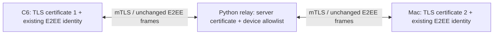

# Falafel laboratory mTLS

Implemented and software-verified 2026-11-12. **Physical mTLS acceptance is not
run.** The user has confirmed the previous TCP/E2EE bidirectional/reset milestone.
No C6 flash, Proxmox access/deployment, firewall/router/systemd change or existing
E2EE identity/store modification was performed during this implementation.

## Boundary and implementation

E2EE authenticates messages and receipts between the paired endpoints and keeps
content encrypted at the relay and in its cache. mTLS authenticates each endpoint
to the relay and the relay to each endpoint, and encrypts their transport links.
The relay terminates TLS and can still see routing IDs, sizes, timing and cached
E2EE ciphertext. TLS acceptance is not an E2EE receipt or mailbox completion.
HELLO2, four-byte framing, envelopes, IDs, retry bytes and persistent formats are
unchanged. Each listener is either TCP or mTLS; neither client downgrades after a
TLS failure. The existing TCP configuration is still available explicitly.



- Relay: Python standard-library SSLContext, CERT_REQUIRED, minimum TLS 1.2,
  TLS 1.3 when OpenSSL supports it. Handshake and I/O remain nonblocking under
  DefaultSelector. Cross-direction WANT_READ/WANT_WRITE, buffered SSL records,
  stable write retries and abrupt EOF/errors are handled. Default combined
  TLS/HELLO deadline: 10 seconds, swept at most every 0.5 seconds; 64 total
  clients and 16 unregistered clients. Configure `--handshake-timeout` (up to
  300 seconds), `--max-clients`, `--max-pending-connections` independently of
  the unchanged cache/output limits. No session tickets or renegotiation.
- Authorization: `--tls-devices` is a JSON object mapping lowercase, unseparated
  SHA-256 fingerprints of DER leaf certificates to numeric IDs. Chain validation
  alone is insufficient: a trusted but unmapped certificate is rejected, and
  a mapped certificate cannot claim another HELLO/HELLO2 ID. Validation occurs
  before replacing the existing same-ID connection. Replacement requires the
  same peer/version, retaining the reset recovery fix and durable replay.
  Mapping is read at startup; certificate rotation/revocation requires editing
  the external allowlist and restarting only this TLS instance. It is independent
  of E2EE key enrollment. Multiple fingerprints for one ID can support a reviewed
  transition, but those clients can displace each other.
- C6 and simulator: shared `shared/network/falafel_tls.c`, using existing
  Mbed TLS 3.6.7. Mandatory CA/hostname or IP-SAN verification, matching client
  key/cert, minimum TLS 1.2. TLS 1.3 is negotiated when compiled in (host build);
  the verified C6 overlay currently uses SDK TLS 1.2. Nonblocking partial TLS I/O
  preserves the existing stream buffers, framing and retry ownership. Teardown
  frees TLS before closing the socket, including Wi-Fi loss and retries.
- C6: TCP connect, TLS handshake and encrypted HELLO2 share a 15-second bound
  (TCP connect itself remains bounded by 5 seconds). The Wi-Fi worker may wait
  for SNTP first, in 15-second intervals. An unset boot clock defers connection.
  `MBEDTLS_HAVE_TIME_DATE` is mandatory; certificate dates are never bypassed.
  The mTLS worker has a 12 KiB stack (TCP retains 8 KiB).
- Credentials: TLS uses its own ECDSA P-256 keys, not the X25519 E2EE keys. The
  C6 embeds external PEM files into its private app image, not NVS. No partition
  change, no extra writes to SDK NVS or `falafel_data`. Rotation requires a new
  app build/flash. Build and credential paths inside this repository are rejected
  for C6 TLS builds; the build directory is made owner-only. The overlay disables
  initial E2EE mailbox creation: existing provisioned storage is required.
  Simulator keys are external owner-owned regular files with no group/other
  permissions; all PEM files are bounded to 16 KiB by its loader. Private key
  buffers are erased after parsing and TLS contexts are freed on disconnect.

The APIs follow [Python's nonblocking SSL guidance](https://docs.python.org/3/library/ssl.html#notes-on-non-blocking-sockets)
and the [Mbed TLS 3.6.7 SSL API](https://github.com/Mbed-TLS/mbedtls/blob/v3.6.7/include/mbedtls/ssl.h).

## Generate a private laboratory PKI

Prerequisite: Python 3.10+ with ssl/OpenSSL, and OpenSSL CLI. Run from the repository root; replace
external paths with private directories. The output directory must not exist.
No existing E2EE identity is read by this tool.

```sh
umask 077
FALAFEL_TLS_DIR="$HOME/falafel-mtls-lab"
python3 tools/generate_tls_credentials.py \
  --output-dir "$FALAFEL_TLS_DIR" \
  --server-dns falafel-relay.lab \
  --server-ip 10.77.0.2
```

Output: `ca.pem`, `ca.key.pem`, `server.pem`, `server.key.pem`, `c6.pem`,
`c6.key.pem`, `simulator.pem`, `simulator.key.pem`, `devices.json`. Files are
0600 in a 0700 directory. CA: CA:TRUE, pathlen:0, keyCertSign/cRLSign; leaves:
CA:FALSE and digitalSignature; server SANs and serverAuth; clientAuth only for
C6/Mac. Lifetime defaults to 365 days (`--days` configurable). Repeat DNS/IP
options for additional SANs. Only the configured TLS verification name must
match the server SAN; it can differ from the IPv4 used to reach a tunnel.

Keep the CA private key offline; never copy it to the relay, C6 or simulator.
Distribute only the CA public certificate and the endpoint's own key/certificate.
The relay additionally needs `devices.json`. Never copy the simulator key to
C6 or vice versa. Generated files and resulting firmware/ELF contain private
keys and must remain external/private. `.gitignore` excludes PEM/key/PKCS files
as a secondary guard; it is not secret storage.

## Local software reproduction

Use the existing pinned dependencies/SDK environment; downloads may be required
for fresh CMake trees. Build the simulator first to enable the C6/SDL integration.

```sh
cmake -S simulator -B build/simulator -G Ninja
cmake --build build/simulator -j4
cmake -S . -B build/mtls-host -G Ninja \
  -DFALAFEL_C6_SIMULATOR_BUILD="$PWD/build/simulator"
cmake --build build/mtls-host -j4
ctest --test-dir build/mtls-host --output-on-failure
ctest --test-dir build/simulator --output-on-failure

cmake -S simulator -B build/mtls-simulator-san -G Ninja \
  -DCMAKE_BUILD_TYPE=Debug \
  '-DCMAKE_C_FLAGS=-fsanitize=address,undefined -fno-omit-frame-pointer' \
  -DCMAKE_EXE_LINKER_FLAGS=-fsanitize=address,undefined
cmake --build build/mtls-simulator-san -j4
cmake -S . -B build/mtls-host-san -G Ninja \
  -DFALAFEL_ENABLE_SANITIZERS=ON \
  -DFALAFEL_C6_SIMULATOR_BUILD="$PWD/build/mtls-simulator-san"
cmake --build build/mtls-host-san -j4
ctest --test-dir build/mtls-host-san --output-on-failure
ctest --test-dir build/mtls-simulator-san --output-on-failure
```

Executed results in the existing isolated build trees:

| Check | Actual result |
|---|---|
| Host normal, `build/sec002/host` | 20/20 PASS |
| Host ASan/UBSan, `build/sec002/host-san` | 20/20 PASS |
| Simulator normal, `build/simulator` | 4/4 PASS |
| Simulator ASan/UBSan, `build/simulator-sage-san` | 4/4 PASS |
| New relay mTLS suite, actual C clients | 17/17 cases PASS in both configurations |
| C6/SDL integration, normal + sanitized | TCP and mTLS bidirectional E2EE/reopen/partial upload PASS; incomplete TLS CLI rejection PASS |
| Fresh C6 IDF 5.5.6 TCP lab build | PASS, 902,144-byte image |
| Fresh C6 IDF 5.5.6 mTLS build | PASS, 877,600-byte image; 105,440-byte app margin |

C6 optimized overlay retains app size `0xf0000`, app offset `0x10000` and
`falafel_data` offset `0x100000`/size `0x100000`. Static DIRAM used 158,640 B;
293,472 B unallocated is not measured runtime heap. The initial debug TLS build
also fit but had little app margin; the separate TLS overlay selects size
optimization and client-only TLS to keep headroom. Production entropy/key
protection gates are not waived by these software results.

The TLS suite covers TLS 1.2/1.3, missing/foreign/unmapped certs, wrong routing ID
without owner eviction, hostname/IP-SAN and foreign-server-CA checks in the real
C clients, wrong key and unsafe key permissions, two peers, lost FIN and RST,
unchanged disk cache after retry, 226-frame replay, handshake/registration
expiry and both connection limits, plaintext/incomplete/empty TLS configuration
rejection, generated X.509 purposes and overwrite refusal, cross-direction SSL
WANTs and stable retries. The C6/SDL test uses actual lab/stream/TLS sources,
real E2EE cryptography and an NVS API model; it verifies exactly one received and
delivered GUI event, one original ID after reopen and no plaintext in saved
mailboxes/cache. It is not physical Wi-Fi, NVS, time or heap validation.
Python is not ASan-instrumented; the C sources are. The sanitized simulator build
also instruments its controller and Mbed TLS dependency. Relevant suites were
rerun after final CLI/validation changes; earlier TLS-version test failure was
fixed by isolating its durable cache between version subtests, not by changing
cache semantics.

## Manual Proxmox staging: separate instance, no current-service changes

**The following deployment and hardware commands are instructions only. None
were executed.** Existing service `falafel-relay`, LXC 100's `10.77.0.2:8765`
and host `192.168.1.200`'s `falafel-lan-proxy.service` remain the TCP baseline.
No new systemd unit is needed for this foreground trial. Confirm port 8766 is
free; do not reuse either existing 8765 listener or its JSON state file.

On the Mac, copy only code plus the server-side TLS credentials:

```sh
ssh root@192.168.1.200 'install -d -m 0700 /root/falafel-mtls-stage'
scp relay/falafel_relay.py relay/tls_auth.py \
  "$FALAFEL_TLS_DIR/ca.pem" "$FALAFEL_TLS_DIR/server.pem" \
  "$FALAFEL_TLS_DIR/server.key.pem" "$FALAFEL_TLS_DIR/devices.json" \
  root@192.168.1.200:/root/falafel-mtls-stage/
```

On Proxmox, first save a private snapshot of the working deployment. This reads
the live atomically replaced JSON without stopping the existing service:

```sh
set -eu
FALAFEL_BACKUP="/root/falafel-before-mtls-$(date +%Y%m%d-%H%M%S)"
pct exec 100 -- install -d -m 0700 "$FALAFEL_BACKUP"
pct exec 100 -- cp -a /opt/falafel/relay "$FALAFEL_BACKUP/relay"
pct exec 100 -- cp -p /var/lib/falafel/state.json "$FALAFEL_BACKUP/state.json"
pct exec 100 -- sh -c 'systemctl cat falafel-relay > "$1/falafel-relay.unit.txt"' sh "$FALAFEL_BACKUP"
install -d -m 0700 "$FALAFEL_BACKUP"
systemctl cat falafel-lan-proxy.service > "$FALAFEL_BACKUP/falafel-lan-proxy.unit.txt"
pct exec 100 -- ss -ltn
```

Inspect the current unit first if its code/data paths differ. Unit snapshots
are kept in the corresponding private backup directories. Then stage the independent
instance using the current relay's service user (empty User means root):

```sh
FALAFEL_USER="$(pct exec 100 -- systemctl show falafel-relay -p User --value)"
FALAFEL_USER="${FALAFEL_USER:-root}"
pct exec 100 -- install -d -m 0755 /opt/falafel-mtls/relay
pct exec 100 -- install -d -m 0700 -o "$FALAFEL_USER" /etc/falafel-mtls /var/lib/falafel-mtls
for FALAFEL_FILE in falafel_relay.py tls_auth.py; do
  pct push 100 "/root/falafel-mtls-stage/$FALAFEL_FILE" "/opt/falafel-mtls/relay/$FALAFEL_FILE"
  pct exec 100 -- chmod 0644 "/opt/falafel-mtls/relay/$FALAFEL_FILE"
done
for FALAFEL_FILE in ca.pem server.pem server.key.pem devices.json; do
  pct push 100 "/root/falafel-mtls-stage/$FALAFEL_FILE" "/etc/falafel-mtls/$FALAFEL_FILE"
  pct exec 100 -- chown "$FALAFEL_USER" "/etc/falafel-mtls/$FALAFEL_FILE"
  pct exec 100 -- chmod 0600 "/etc/falafel-mtls/$FALAFEL_FILE"
done
pct exec 100 -- runuser -u "$FALAFEL_USER" -- python3 \
  /opt/falafel-mtls/relay/falafel_relay.py \
  --host 10.77.0.2 --port 8766 --pair 1:2 --e2ee-only \
  --data /var/lib/falafel-mtls/state.json \
  --tls-ca /etc/falafel-mtls/ca.pem \
  --tls-cert /etc/falafel-mtls/server.pem \
  --tls-key /etc/falafel-mtls/server.key.pem \
  --tls-devices /etc/falafel-mtls/devices.json
```

Leave this foreground process running in its terminal. Do not run a second TLS
relay writer against the same JSON file. Python/OpenSSL must support TLS >=1.2;
no additional Python packages are required. CA signing key/client keys never go
to Proxmox. Do not restart or replace the current relay/proxy service.

## Hardware trial through a temporary SSH tunnel

This avoids new Proxmox listener/proxy/firewall configuration. From the Mac,
choose its existing reachable LAN IPv4 (not the Proxmox address), then keep the
SSH tunnel running in a second terminal. `-g` deliberately allows the C6 to reach
this mTLS-only forwarded port on the Mac LAN interface:

```sh
FALAFEL_MAC_LAN_IP=192.168.1.REPLACE_WITH_MAC_HOST
ssh -N -g -o ExitOnForwardFailure=yes \
  -L "$FALAFEL_MAC_LAN_IP:8766:10.77.0.2:8766" root@192.168.1.200
```

If the existing network/Mac policy blocks that listener or the SSH host cannot
reach the LXC sidecar, stop the trial and review connectivity separately. These
instructions do not alter any firewall/router settings. TLS still terminates at
the relay; the tunnel does not decrypt it. The server verification name remains
`falafel-relay.lab` even though clients connect to the Mac IPv4.

For C6, use a NEW external build directory and the C6 TLS key/certificate:

```sh
umask 077
FALAFEL_TLS_BUILD="$HOME/falafel-c6-mtls-build"
bash tools/with-idf-5.5.6.sh idf.py -C firmware -B "$FALAFEL_TLS_BUILD" \
  -DIDF_TARGET=esp32c6 -DSDKCONFIG="$FALAFEL_TLS_BUILD/sdkconfig" \
  '-DSDKCONFIG_DEFAULTS=sdkconfig.storage.defaults;sdkconfig.c6-lab.defaults;sdkconfig.c6-mtls.defaults' \
  -DFALAFEL_TLS_CA_FILE="$FALAFEL_TLS_DIR/ca.pem" \
  -DFALAFEL_TLS_CERT_FILE="$FALAFEL_TLS_DIR/c6.pem" \
  -DFALAFEL_TLS_KEY_FILE="$FALAFEL_TLS_DIR/c6.key.pem" menuconfig
bash tools/with-idf-5.5.6.sh idf.py -C firmware -B "$FALAFEL_TLS_BUILD" build size
```

In menuconfig set existing Wi-Fi credentials, own=1/peer=2, relay IPv4 to the
Mac tunnel's LAN address, port=8766, TLS name=`falafel-relay.lab` and an actually
available trusted LAN SNTP server. Do not assume Proxmox provides NTP. Leave
mailbox creation disabled. Confirm Secure Boot/Flash Encryption remain disabled,
partition layout unchanged and app fits. Do not reuse the disposable test PKI/
build in `/private/tmp`; generate your reviewed lab credentials as above.

Before any later authorized app flash, retain a private copy of the old app:

```sh
FALAFEL_PORT=/dev/cu.REPLACE_WITH_C6_PORT
FALAFEL_DEVICE_BACKUP="$HOME/falafel-c6-before-mtls"
mkdir -m 0700 "$FALAFEL_DEVICE_BACKUP"
bash tools/with-idf-5.5.6.sh python -m esptool --chip esp32c6 \
  --port "$FALAFEL_PORT" read_flash 0x10000 0xf0000 \
  "$FALAFEL_DEVICE_BACKUP/original-app.bin"
# App only: preserves bootloader, partition table, SDK NVS and falafel_data.
bash tools/with-idf-5.5.6.sh idf.py -C firmware -B "$FALAFEL_TLS_BUILD" \
  -p "$FALAFEL_PORT" app-flash monitor
```

These commands assume the existing verified 2 MiB storage layout. Do not use
`erase-flash`, the identity provisioner, an NVS image or a different partition
table to test TLS. The app backup also contains the old Wi-Fi configuration;
keep it private. No device commands were executed during implementation.

Stop the old simulator before opening its same stores in mTLS mode. Set the
three variables below to its actual EXISTING identity, mailbox and history:

```sh
FALAFEL_SIM_IDENTITY=/ABS/PATH/TO/EXISTING/2.identity
FALAFEL_SIM_MAILBOX=/ABS/PATH/TO/EXISTING/2.mail
FALAFEL_SIM_HISTORY=/ABS/PATH/TO/EXISTING/HISTORY
build/simulator/falafel_simulator --device 2 --peer 1 \
  --host "$FALAFEL_MAC_LAN_IP" --port 8766 \
  --identity "$FALAFEL_SIM_IDENTITY" --mailbox "$FALAFEL_SIM_MAILBOX" \
  --history "$FALAFEL_SIM_HISTORY" \
  --tls-ca "$FALAFEL_TLS_DIR/ca.pem" \
  --tls-cert "$FALAFEL_TLS_DIR/simulator.pem" \
  --tls-key "$FALAFEL_TLS_DIR/simulator.key.pem" \
  --tls-server-name falafel-relay.lab
```

No `--init-history` or new E2EE fixture is needed. Expected hardware acceptance:
SNTP sync, RESTORED for the existing preset, TLS identity verified, stable HELLO2,
new Mac text authenticated on C6 and its authenticated receipt accepted on Mac.
A previously completed automatic C6 preset must NOT get a new ID just for this
trial; it is not resent as a new message after boot. Use any still-pending
preset to verify DATA in that direction; receipt traffic also exercises C6 ->
Mac through TLS. Retain the eight lifetime C6 records/direction limit: FULL
requires a separately reviewed retention plan, never erase/reprovision.
Repeat RESET/EN and network interruptions without restarting the TLS relay;
verify no duplicate rows/new preset ID and record free/minimum heap, largest
block and stack margin. TLS errors must retry only TLS and never emit a delivery
success. Automated negative certificate/ID tests are software evidence, not a
claim of physical execution.

## Rollback and remaining risks

Close the mTLS simulator and SSH tunnel; Ctrl-C the foreground TLS relay. The
existing TCP service/proxy were untouched and remain the original endpoint.
After stopping the serial monitor, restore only the saved C6 app if needed:

```sh
bash tools/with-idf-5.5.6.sh python -m esptool --chip esp32c6 \
  --port "$FALAFEL_PORT" write_flash 0x10000 \
  "$FALAFEL_DEVICE_BACKUP/original-app.bin"
```

Relaunch the original simulator command with the original TCP host/port and same
stores, omitting TLS options explicitly. Preserve all CURRENT E2EE/NVS/history
and relay state: do not restore stale state snapshots to roll back software.
No systemd/firewall rollback is needed because none were changed. Review a
permanent TLS listener/service/proxy migration only after physical acceptance.

Residual limits: private TLS/E2EE keys remain extractable from plaintext flash,
firmware artifacts or desktop files; Secure Boot/Flash Encryption are not
activated. SNTP bootstrap is not authenticated and needs a trusted LAN/time
source or a future protected clock. No hardware entropy/protected-key approval,
CRL/OCSP automation, certificate renewal service, online allowlist reload,
Internet hardening or TLS rate limiting beyond connection counts/timeouts.
A compromised authorized certificate can impersonate its routing ID until
removed/restarted, but cannot forge the other endpoint's E2EE identity. The
relay can still deny service, withhold/replay valid ciphertext and observe
metadata; cache exhaustion and long-term retention remain existing limits.


## Files created and modified

Created:

- `docs/mtls.md`
- `firmware/main/relay_tls.c`
- `firmware/main/relay_tls.h`
- `firmware/sdkconfig.c6-mtls.defaults`
- `relay/tls_auth.py`
- `shared/include/falafel_tls.h`
- `shared/network/falafel_tls.c`
- `test/test_relay_tls.py`
- `test/tls_client_probe.c`
- `tools/generate_tls_credentials.py`

Modified (including verification and documentation):

- `.gitignore`
- `CMakeLists.txt`
- `README.md`
- `backend/README.md`
- `cmake/simulator_messaging.cmake`
- `docs/CHANGELOG.md`
- `docs/PROJECT_STATUS.md`
- `docs/application-persistence.md`
- `docs/architecture.md`
- `docs/async-e2ee-design.md`
- `docs/c6-relay-transport.md`
- `docs/embedded-storage.md`
- `docs/protocol.md`
- `experiments/desktop-mailbox/README.md`
- `firmware/README.md`
- `firmware/components/README.md`
- `firmware/main/CMakeLists.txt`
- `firmware/main/Kconfig.projbuild`
- `firmware/main/relay_network.c`
- `firmware/main/relay_tcp.c`
- `firmware/main/relay_tcp.h`
- `firmware/sdkconfig.c6-lab.defaults`
- `relay/README.md`
- `relay/falafel_relay.py`
- `simulator/README.md`
- `simulator/src/desktop_transport.c`
- `simulator/src/desktop_transport.h`
- `simulator/src/main.c`
- `simulator/src/messaging_controller.c`
- `simulator/src/messaging_controller.h`
- `test/c6_lab_probe.c`
- `test/test_c6_simulator.py`
